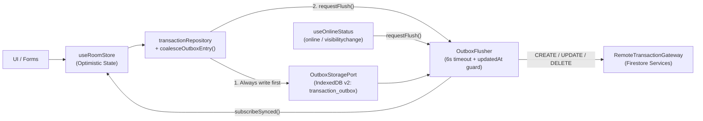

# Zentro-money — Offline Transactions & Outbox Sync

This document describes how **Zentro-money** persists, coalesces, and synchronizes room transactions across offline and online states using the **Transactional Outbox + Command Coalescing + Ports & Adapters** pattern.

---

## 1. Architecture & Layer Responsibilities

Neither React components nor `useRoomStore` check `navigator.onLine` or decide between `IndexedDB` and `Firestore`. Every mutation follows a single unidirectional pipeline:

1. **`useRoomStore` (Optimistic UI Projection)** — updates `room.transactions` and `userRooms` in memory (`SyncStatus.PENDING`) and delegates the intent to `transactionRepository`.
2. **`IndexedDB` (`zentro-offline-db` v2, `transaction_outbox`)** — stores unacknowledged operations (`CREATE | UPDATE | DELETE`) indexed by `roomId` (`by_room`).
3. **`OutboxFlusher` + `RemoteTransactionGateway`** — the **only** layer aware of network connectivity; drains `transaction_outbox` into the remote backend (`Firestore`) and notifies the store (`SyncStatus.SYNCED`).

---

## 2. Command Coalescing Rules (`coalesceOutboxEntry`)

When multiple edits happen before an item reaches the server, `coalesceOutboxEntry` collapses them per `transactionId` into minimal remote work:

| Existing Outbox Entry | Incoming Action | Resulting Outbox Entry                         | Remote Effect When Online                       |
| :-------------------- | :-------------- | :--------------------------------------------- | :---------------------------------------------- |
| `None`                | `CREATE`        | `CREATE` (new payload)                         | Calls `gateway.create`                          |
| `None`                | `UPDATE`        | `UPDATE` (new payload)                         | Calls `gateway.update`                          |
| `None`                | `DELETE`        | `DELETE` (no payload)                          | Calls `gateway.remove`                          |
| `CREATE`              | `UPDATE`        | `CREATE` (merged payload, bumped `updatedAt`)  | Single `gateway.create` with final values       |
| `CREATE`              | `DELETE`        | `null` (removed from `transaction_outbox`)     | **Zero network requests** (annihilated locally) |
| `UPDATE`              | `UPDATE`        | `UPDATE` (latest payload, bumped `updatedAt`)  | Single `gateway.update`                         |
| `UPDATE`              | `DELETE`        | `DELETE` (payload dropped, bumped `updatedAt`) | Single `gateway.remove`                         |

When opening or reloading a room (`fetchTransactions` / `hydrateTransactionsFromQueue`), `applyOutboxToRoomTransactions` overlays room-scoped `CREATE` and `UPDATE` entries (`SyncStatus.PENDING`), hides `DELETE` entries, and prunes stale `CREATE` entries already returned by the server.

---

## 3. Online Detection, Lie-Fi Timeout & Race Protection

- **Wake-up triggers**:
  1. Immediately after `enqueueCreate` / `enqueueUpdate` / `enqueueDelete` (`requestFlush()`).
  2. Browser `window` `'online'` event (`useOnlineStatus`).
  3. `document` `'visibilitychange'` when returning to `'visible'` (handles Telegram Mini App background resume).
  4. Application startup when `navigator.onLine === true`.
- **Lie-Fi guard (`DEFAULT_OUTBOX_TIMEOUT_MS = 6000`)**:
  - If `navigator.onLine === false`, `requestFlush()` exits immediately.
  - Because Firestore's `persistentLocalCache` keeps `setDoc` promises pending while offline, each gateway call is wrapped in `withRequestTimeout(..., 6000)`. On timeout or error, the flush loop stops cleanly and keeps items in `transaction_outbox` (`SyncStatus.PENDING`) until the next trigger.
- **In-flight edit guard (`updatedAt`)**:
  - After `gateway` acknowledges an entry, `OutboxFlusher` re-reads `storage.getById(transactionId)`.
  - It deletes the entry and emits `onEntrySynced` **only if `latest.updatedAt === sent.updatedAt`**. If the user edited the transaction while the request was in flight, the newer mutation stays queued and is sent on an immediate follow-up pass.

---

## 4. How to Add a New Persistence Backend (Ports & Adapters)

Core sync logic depends only on port types in `src/types/outbox.ts` (`OutboxStoragePortType` and `RemoteTransactionGatewayType`):

1. Implement `RemoteTransactionGatewayType` (`create`, `update`, `remove`) in a new adapter (e.g., `src/lib/api-transaction-gateway.ts` for REST/Supabase).
2. Keep SDK-specific serialization inside the adapter boundary (for example, `firestore-transaction-gateway.ts` strips client-only `syncStatus` and normalizes `Timestamp` values).
3. Pass the new `gateway` (or custom `storage`) to `createTransactionRepository({ gateway, storage })` in `src/lib/transaction-repository.ts` — no changes required in UI, forms, or `useRoomStore`.

---

## 5. Module Map

| File                                       | Responsibility                                                                                                                      |
| :----------------------------------------- | :---------------------------------------------------------------------------------------------------------------------------------- |
| `src/types/outbox.ts`                      | `OutboxOperation`, `OutboxEntryType`, `OutboxStoragePortType`, `RemoteTransactionGatewayType`                                       |
| `src/constants/db.ts`                      | `INDEX_DB_NAME` (`zentro-offline-db`), `OBJECT_STORE_TRANSACTION_OUTBOX` (`transaction_outbox`), `INDEX_OUTBOX_BY_ROOM` (`by_room`) |
| `src/lib/offline-db.ts`                    | Lazy `IndexedDB` v2 initialization + automatic v1 (`transactions`) -> v2 (`transaction_outbox`) migration                           |
| `src/lib/restore-timestamp.ts`             | Restores `Timestamp` instances from structured-cloned `{ seconds, nanoseconds }`, `Date`, ISO strings, or ms                        |
| `src/lib/coalesce-outbox-entry.ts`         | Pure state-machine coalescing (`coalesceOutboxEntry`) and room list projection (`applyOutboxToRoomTransactions`)                    |
| `src/lib/indexeddb-outbox-storage.ts`      | `OutboxStoragePortType` adapter over `IndexedDB` (`by_room` index queries + timestamp normalization)                                |
| `src/lib/firestore-transaction-gateway.ts` | `RemoteTransactionGatewayType` adapter delegating to `createTransaction`, `updateTransaction`, `deleteTransactionById`              |
| `src/lib/outbox-flusher.ts`                | Single-flight sequential queue worker with `6000ms` timeout and `updatedAt` concurrency check                                       |
| `src/lib/transaction-repository.ts`        | Facade used by `useRoomStore` and `useOnlineStatus` (`enqueueCreate/Update/Delete`, `hydrateRoomTransactions`, `subscribeSynced`)   |
